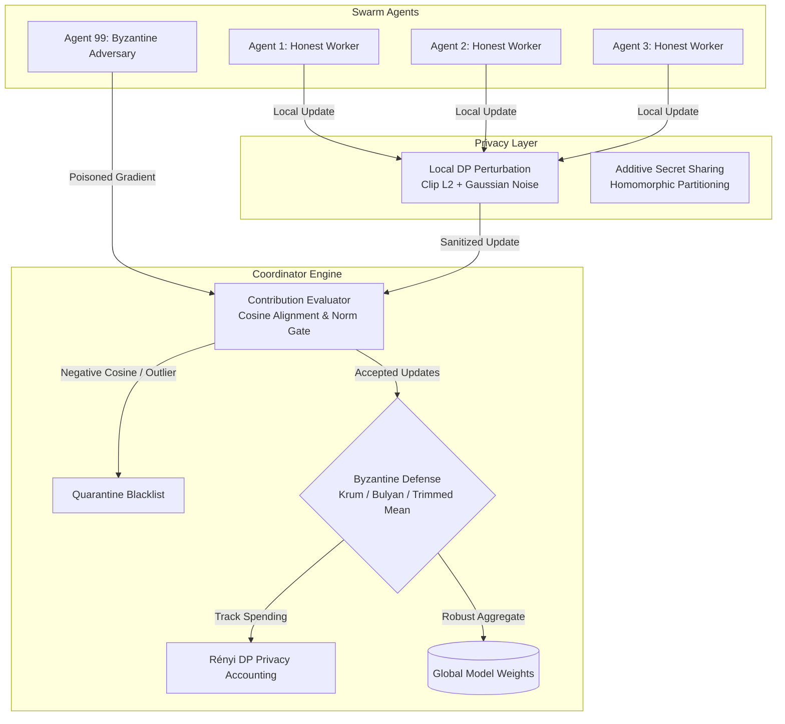

# agent-federated-learning

[](https://github.com/devsoniclk/agent-federated-learning/actions/workflows/ci.yml)
[](https://opensource.org/licenses/MIT)
[](https://www.python.org/downloads/)
[](https://github.com/astral-sh/ruff)

Privacy-Preserving Federated Learning & Byzantine-Robust Swarm Model Aggregation Engine for Autonomous AI Agents.

---

## Overview

In decentralized multi-agent networks, autonomous agents continuously fine-tune local models on private observations, tool execution traces, and domain interactions. Centralizing raw training data introduces severe privacy leakage, regulatory exposure, and competitive risk. Conversely, naive parameter sharing (e.g., standard Federated Averaging) is vulnerable to **Byzantine failures, adversarial gradient inversion, data poisoning, and free-riding**.

`agent-federated-learning` provides a production-grade, mathematically verified algorithmic runtime for decentralized AI swarms, featuring:
1. **Byzantine-Robust Aggregation**: Theoretical resilience against up to $m$ arbitrary adversarial agents via **Krum**, **Multi-Krum**, **Trimmed Mean**, **Coordinate Median**, and **Bulyan**.
2. **Differential Privacy Guarantee**: Local gradient clipping and calibrated Gaussian perturbation with **Rényi Differential Privacy (RDP)** cumulative budget tracking $(\epsilon, \delta)$.
3. **Secure Multiparty Computation (SMPC)**: Additive secret sharing allowing non-colluding agent swarms to aggregate gradients without exposing individual parameters.
4. **Swarm Contribution Auditing**: Directional cosine alignment, outlier norm filtering, and **Monte Carlo Data Shapley value** estimation for fair valuation and automated quarantine.
5. **FastMCP Integration**: Native Model Context Protocol stdio JSON-RPC 2.0 server exposing 7 tools directly to Claude, OpenBot, and LLM orchestrators.

---

## Architectural Workflow



---

## Mathematical Formulations

### 1. Byzantine-Robust Aggregation

#### Krum (Blanchard et al.)
Given $n$ agent vectors $v_1, \dots, v_n$ where at most $m$ are Byzantine ($n \ge 2m + 3$), Krum selects the single vector $v_i$ that minimizes the sum of squared Euclidean distances to its $n - m - 2$ closest neighbors $\mathcal{N}_i$:
$$s(i) = \sum_{j \in \mathcal{N}_i} \|v_i - v_j\|_2^2$$
$$i^* = \arg\min_i s(i)$$

#### Multi-Krum
Selects the top $k$ candidates with the lowest Krum scores and computes their arithmetic mean, reducing variance while maintaining Byzantine resilience.

#### Bulyan (Guerraoui et al.)
Combines Krum iterative selection with coordinate-wise trimmed mean:
1. Iteratively applies Krum to select a subset $\mathcal{S}$ of $\theta = n - 2m$ candidates.
2. For each parameter coordinate $k$, computes the mean of the $\theta - 2\gamma$ median values, discarding the $\gamma$ largest and $\gamma$ smallest coordinates.

#### Coordinate-wise Trimmed Mean
For each parameter index $j$, trims the highest $\beta$ and lowest $\beta$ values across agents before computing the coordinate average:
$$w_{\text{agg}, j} = \frac{1}{n - 2m} \sum_{i=m+1}^{n-m} v_{(i), j}$$

---

### 2. Differential Privacy & Rényi DP

To provide $(\epsilon, \delta)$-differential privacy guarantees:
1. **L2 Gradient Clipping**:
   $$\bar{v}_i = v_i \cdot \min\left(1, \frac{C}{\|v_i\|_2}\right)$$
2. **Calibrated Gaussian Perturbation**:
   $$\tilde{v}_i = \bar{v}_i + \mathcal{N}\left(0, \sigma^2 C^2 I\right), \quad \sigma = \text{noise\_multiplier}$$
3. **Rényi Differential Privacy Composition**:
   For Gaussian mechanism with sampling ratio $q=1$, order $\alpha$, and $T$ rounds:
   $$\epsilon_{\text{RDP}}(\alpha) = \frac{T \alpha}{2 \sigma^2}$$
   Converted to standard $(\epsilon, \delta)$ guarantee:
   $$\epsilon(\delta) = \min_{\alpha > 1} \left( \epsilon_{\text{RDP}}(\alpha) + \frac{\ln(1/\delta)}{\alpha - 1} \right)$$

---

### 3. Data Shapley Valuation

The marginal contribution of agent $i$ to a coalition $S \subseteq N \setminus \{i\}$ is evaluated against target direction $v_{\text{target}}$:
$$\phi_i = \frac{1}{|N|!} \sum_{\pi \in \Pi} \left[ U(S_\pi^i \cup \{i\}) - U(S_\pi^i) \right]$$
where utility $U(S) = \text{CosineSimilarity}\left(\frac{1}{|S|} \sum_{j \in S} v_j, v_{\text{target}}\right)$, approximated via Monte Carlo permutation sampling.

---

## Installation

```bash
pip install agent-federated-learning
```

Or using `uv`:
```bash
uv add agent-federated-learning
```

---

## FastMCP Tool Reference

The included stdio server (`agent-fl serve`) exposes 7 tools to agent runtimes:

| Tool | Signature | Description |
| :--- | :--- | :--- |
| `fl_create_round` | `(defense_type, min_required_updates, dp_enabled, epsilon, delta)` | Create and open a new federated training round |
| `fl_submit_update` | `(round_id, agent_id, parameters, sample_count, loss)` | Submit local model gradient or weight dictionary |
| `fl_aggregate_round` | `(round_id, byzantine_tolerance)` | Execute Byzantine-robust aggregation and update global weights |
| `fl_get_global_model` | `()` | Retrieve current aggregated global weights |
| `fl_evaluate_contributions` | `(round_id)` | Audit updates for directional inversion and norm explosion |
| `fl_verify_privacy_budget` | `()` | Audit cumulative RDP expenditure across completed rounds |
| `fl_get_swarm_status` | `()` | Query active rounds, quarantine list, and coordinator metrics |

---

## Command-Line Interface (CLI)

```bash
# Check status
agent-fl status

# Create a round with Bulyan defense and Differential Privacy
agent-fl round create --defense bulyan --min-updates 5 --dp-enabled --epsilon 1.5

# Submit model updates
agent-fl round submit --round-id 1 --agent-id agent-01 --params-json '{"weights": [0.1, 0.2]}'

# Evaluate updates for anomalies
agent-fl evaluate --round-id 1

# Execute robust aggregation
agent-fl round aggregate --round-id 1 --byzantine-tolerance 1

# Inspect new global model
agent-fl model get

# Audit privacy spending
agent-fl privacy audit
```

---

## Python API Quickstart

```python
from agent_federated_learning.coordinator import FederatedSwarmCoordinator
from agent_federated_learning.models import ByzantineDefenseType, DifferentialPrivacyConfig, ModelUpdate

# Initialize coordinator
coord = FederatedSwarmCoordinator(
    model_id="agent-llama-lora",
    initial_parameters={"lora_a": [0.0, 0.0], "lora_b": [0.0, 0.0]},
    default_defense=ByzantineDefenseType.BULYAN,
    default_dp=DifferentialPrivacyConfig(enabled=True, epsilon=2.0)
)

# Start round
coord.start_round(min_required_updates=3)

# Submit honest updates
coord.submit_update(ModelUpdate(agent_id="agent-1", round_id=1, parameters={"lora_a": [1.0, 1.0], "lora_b": [0.5, 0.5]}))
coord.submit_update(ModelUpdate(agent_id="agent-2", round_id=1, parameters={"lora_a": [1.05, 0.95], "lora_b": [0.52, 0.48]}))

# Submit adversarial update (sign inversion)
coord.submit_update(ModelUpdate(agent_id="bad-agent", round_id=1, parameters={"lora_a": [-10.0, -10.0], "lora_b": [-5.0, -5.0]}))

# Aggregate with Bulyan defense
result = coord.aggregate_round(round_id=1, byzantine_tolerance=1)
print(f"Aggregation complete! Rejected: {result.rejected_agents}")
print("Updated Global Model:", coord.get_global_model())
```

---

## Testing & Quality Assurance

```bash
pytest --cov=agent_federated_learning --cov-report=term-missing
```

---

## License

MIT © [Lakshitha Dananjaya](https://github.com/devsoniclk)
